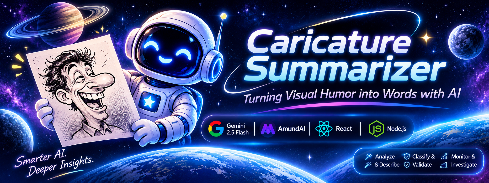
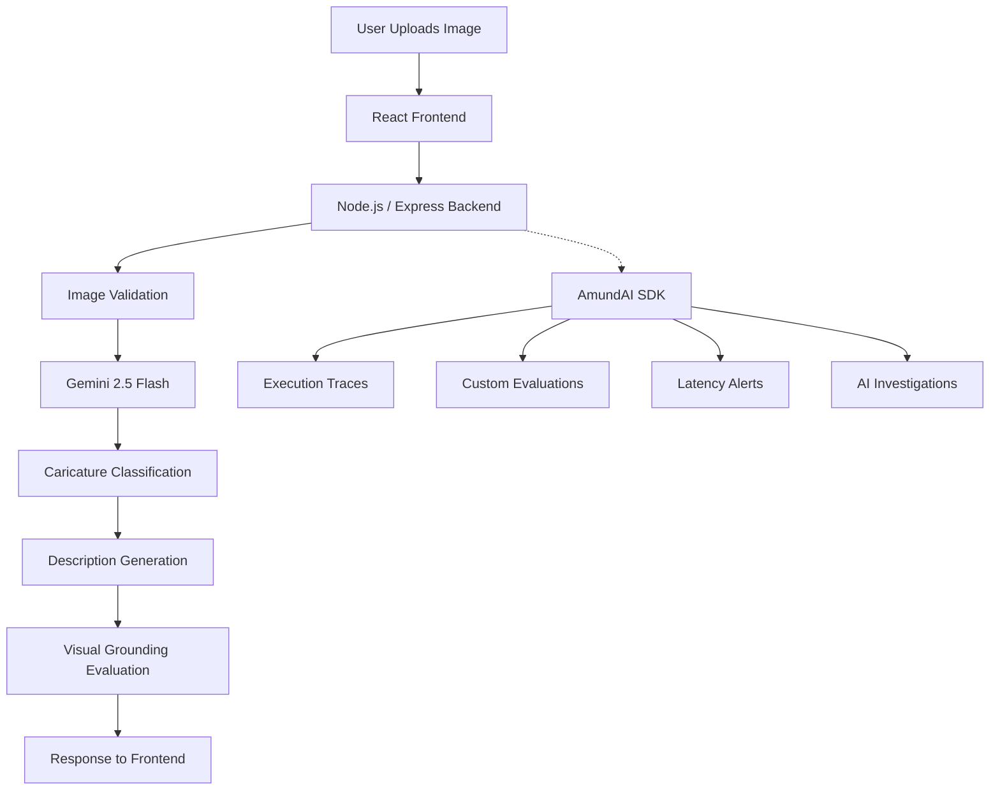

# Caricature Summarizer

### Turning Visual Humor into Words with AI

<p align="center">
  
</p>

<p align="center">
  An AI-powered application that analyzes caricature artwork and transforms its visual characteristics into meaningful, engaging descriptions.
</p>

<p align="center">
  
  
  
  
</p>

---

## 1. Project Overview

Caricature Summarizer is a full-stack AI application designed to interpret caricature illustrations and convert their visual characteristics into engaging textual descriptions.

Powered by Google's Gemini 2.5 Flash multimodal model, the application analyzes uploaded images to identify visible facial features, exaggerated proportions, expressions, artistic techniques, and stylistic elements.

Beyond AI-generated descriptions, the project integrates **AmundAI** for AI observability and evaluation. This enables execution tracing, custom evaluation rubrics, latency monitoring, and AI-assisted investigations.

The project explores an important aspect of building reliable AI applications: evaluating not only whether an AI system executes successfully, but also whether its output achieves the intended task accurately.

## 2. Key Features

| Feature | Description |
|---|---|
| Image Upload | Accepts supported image formats for analysis |
| AI Image Analysis | Uses Gemini 2.5 Flash for multimodal image understanding |
| Caricature Classification | Identifies whether an uploaded image represents a caricature |
| Description Generation | Produces engaging descriptions based on visible artistic characteristics |
| Visual Grounding Evaluation | Evaluates whether generated descriptions are supported by the original image |
| Custom Evaluation Rubrics | Measures task-specific quality and reliability |
| Execution Tracing | Monitors individual executions and model operations |
| Performance Monitoring | Tracks execution latency, token usage, and estimated cost |
| Reliability Alerts | Configures latency thresholds and automated investigation triggers |
| AI Investigations | Examines failures and performance anomalies using trace evidence |

## 3. Technology Stack

| Component | Technology |
|---|---|
| Frontend | React, Vite, CSS |
| Backend | Node.js, Express.js |
| AI Model | Google Gemini 2.5 Flash |
| AI Observability | AmundAI |
| AI Integration | Google Generative AI SDK |
| Image Upload | Multer |
| Development | Visual Studio Code |
| Version Control | Git and GitHub |

## 4. System Architecture

The application follows a frontend-backend architecture with a multimodal AI processing pipeline and an observability layer.



### Processing Workflow

1. The user uploads an image through the React interface.
2. The backend validates the uploaded file and its image signature.
3. The image is passed to Gemini 2.5 Flash for multimodal analysis.
4. The model classifies the input and generates a description when appropriate.
5. A separate image-aware evaluation checks the generated description against the original image.
6. Execution details and evaluation information are recorded through AmundAI.
7. The generated result is returned to the frontend.

## 5. AI Observability with AmundAI

AmundAI is integrated to monitor the application's execution behavior, evaluate output quality, and investigate potential reliability issues.

### Platform Features Used

| AmundAI Feature | Purpose |
|---|---|
| Home | Monitor agent activity, execution summaries, and outcomes |
| Traces | Inspect execution paths, spans, latency, errors, token usage, and estimated cost |
| Evals | Configure custom evaluation rubrics and review evaluation scores |
| Investigations | Analyze failures and performance anomalies using collected evidence |
| Reliability and Alerts | Configure latency thresholds and investigation triggers |

### Custom Evaluation Framework

Generic success criteria are insufficient for evaluating AI agents. A technically successful API response does not necessarily mean that the agent has completed its intended task correctly.

To address this, seven task-specific and quality-oriented evaluation checks were configured.

| Evaluation Rubric | Evaluation Objective |
|---|---|
| Caricature Classification Accuracy | Evaluates whether the input is correctly classified |
| Artistic Eye | Evaluates the quality of visual and artistic interpretation |
| Helpfulness | Measures the usefulness and relevance of the generated description |
| Trajectory Coherence | Evaluates consistency across execution steps |
| Hallucination | Checks for unsupported or invented information |
| PII Leakage | Checks for unintended exposure of personal information |
| Toxicity | Checks for harmful or inappropriate content |

**Observed evaluation result: 7/7 checks passed** on the reported successful test executions.

These results represent the tested executions and do not guarantee that every future execution will pass.

## 6. Product Testing and Issues Identified

Testing involved examining both the application itself and the observability platform used to monitor it.

The issues were categorized into application-level issues and platform-level issues.

### 6.1 Application-Level Issues

**Issue 1: Incorrect Input Acceptance**

The application required stronger input validation to distinguish genuine caricatures from normal photographs and unrelated content.

Unsupported file formats also required rejection at the upload-validation stage.

**Expected Improvement:**
- Validate supported image formats.
- Verify image file signatures.
- Reject unsupported file types.
- Improve semantic classification of non-caricature images.

**Issue 2: Visual Grounding and Evaluation Accuracy**

The Gemini generation request received the uploaded image, but the AmundAI trace recorded image metadata rather than the original image itself.

Consequently, a text-based evaluator could lack the visual evidence needed to verify whether a generated description accurately represented the image.

**Expected Improvement:**
- Introduce a separate image-aware evaluation process.
- Pass the original image and generated description to the evaluator.
- Record the evaluation as a separate execution span.
- Assess whether descriptions are grounded in visible image details.

### 6.2 Platform-Level Issues

**Issue 1: Dashboard Refresh Delay**

The evaluation dashboard initially displayed 5/5 checks and subsequently displayed 7/7 after refreshing.

This indicated a stale dashboard display during the observed test, although the underlying cause was not established.

**Issue 2: Limited Flexibility in Defining Custom Agent Success Criteria**

During testing, I identified a limitation in defining what constitutes a successful agent execution. Generic success indicators may confirm that an agent completed its execution, but they do not necessarily establish whether the intended task was completed correctly.

Different agents have different objectives and output requirements. Without flexible, task-specific success criteria, it can be difficult to distinguish successful execution from actual task success.

## 7. Improvements Implemented

The following improvements were introduced during development and testing:

| Area | Improvement |
|---|---|
| Input Validation | Added supported-format and image-signature validation |
| Visual Evaluation | Introduced a separate image-aware Gemini evaluation |
| Observability | Recorded generation and evaluation as separate AmundAI spans |
| Evaluation | Configured seven custom evaluation rubrics |
| Performance | Added generation and evaluation latency measurements |
| Reliability | Configured latency threshold alerts |
| Error Handling | Added handling for transient model errors and quota exhaustion |

## 8. Performance Analysis

Four successful executions were analyzed to understand processing-time variation.

| Metric | Observed Result |
|---|---:|
| Fastest execution | 15 seconds |
| Slowest execution | 29 seconds |
| Average execution time | 21.25 seconds |
| Configured latency alert threshold | 25,000 ms |

The execution duration includes both Gemini description generation and visual grounding evaluation.

These measurements represent a small test sample and should not be interpreted as a comprehensive performance benchmark.

## 9. AI-Assisted Investigation

AmundAI's Investigations feature was used to examine latency-related failures.

### Investigation Finding: Gemini API Request Quota Exhaustion

An investigation identified Google Gemini API request quota exhaustion as a likely explanation for several failed executions.

The investigation examined three failed traces, each containing quota-related API errors associated with the Gemini 2.5 Flash model.

**Evidence examined:**
- Three failed execution traces.
- Google Gemini API quota error messages.
- Correlation between failed model requests and latency-related alerts.

**Recommendations identified:**
- Review API usage and quota limits.
- Consider an appropriate API billing plan.
- Implement retry handling for transient failures.
- Distinguish quota exhaustion from temporary service errors.

The investigation provided a useful diagnostic hypothesis supported by trace evidence. It did not automatically resolve the underlying API quota limitation.

## 10. Project Structure

```text
Caricature-summarizer/
│
├── backend/
│   ├── server.js
│   ├── package.json
│   ├── package-lock.json
│   └── .env.example
│
├── frontend/
│   ├── public/
│   ├── src/
│   ├── package.json
│   └── vite.config.js
│
├── docs/
│   ├── banner.png
│   └── evidence/
│       ├── application.jpg
│       ├── traces.jpg
│       ├── evaluations.jpg
│       └── investigations.jpg
│
├── .gitignore
└── README.md
```

## 11. Installation and Setup

### Prerequisites

- Node.js and npm
- Git
- Google Gemini API key
- AmundAI API key

### Step 1: Clone the Repository

```bash
git clone https://github.com/Nabiha-2128/Caricature-summarizer.git

cd Caricature-summarizer
```

### Step 2: Install Backend Dependencies

```bash
cd backend
npm install
```

### Step 3: Configure Environment Variables

Create a `.env` file inside the backend directory.

Use the following configuration:

```env
GEMINI_API_KEY=your_gemini_api_key
MORSE_API_KEY=your_amundai_api_key
PORT=5000
```

Refer to `backend/.env.example` for the required variable names.

Keep the actual `.env` file private. Never commit API keys or secrets to GitHub.

### Step 4: Start the Backend

From the backend directory:

```bash
node server.js
```

The backend runs on port 5000 by default.

### Step 5: Install Frontend Dependencies

Open a separate terminal:

```bash
cd frontend
npm install
```

### Step 6: Start the Frontend

```bash
npm run dev
```

Open the local URL displayed by Vite in your browser.

## 12. Screenshots and Evidence

Screenshots documenting the application and its observability results can be added here.

### Application Interface

Add screenshots demonstrating the image upload interface and generated descriptions.

### AmundAI Execution Traces

Add screenshots showing execution traces, model spans, latency, and token usage.

### Custom Evaluation Results

Add screenshots showing the seven configured evaluation rubrics and their results.

### Investigation Evidence

Add screenshots of the completed latency investigation and its supporting evidence.

Suggested screenshot locations:

```text
docs/evidence/application.jpg
docs/evidence/traces.jpg
docs/evidence/evaluations.jpg
docs/evidence/investigations.jpg
```

## 13. Future Enhancements

- Multilingual caricature descriptions.
- Improved classification using a larger validation dataset.
- More comprehensive visual grounding benchmarks.
- Automated regression testing for evaluation rubrics.
- Larger-scale latency and reliability analysis.
- Improved handling of API quotas and model availability.
- Expanded monitoring of application-level performance.

## 14. Key Learnings

This project provided practical experience in:

- Integrating multimodal AI models into a full-stack application.
- Building image upload and validation workflows.
- Designing custom success criteria for AI agents.
- Understanding the difference between technical execution success and task-level success.
- Developing task-specific evaluation rubrics.
- Implementing visual grounding evaluation.
- Monitoring AI executions through traces and spans.
- Investigating latency variations and API failures.
- Using observability evidence to improve AI application reliability.

## 15. Author

**Nabihg Noorul Ashika B**

AI and Full-Stack Development Enthusiast

GitHub: [Nabiha-2128](https://github.com/Nabiha-2128)

Project Repository: [Caricature Summarizer](https://github.com/Nabiha-2128/Caricature-summarizer)

---

<p align="center">
  <strong>Building AI applications with a focus on accuracy, evaluation, and reliability.</strong>
</p>
